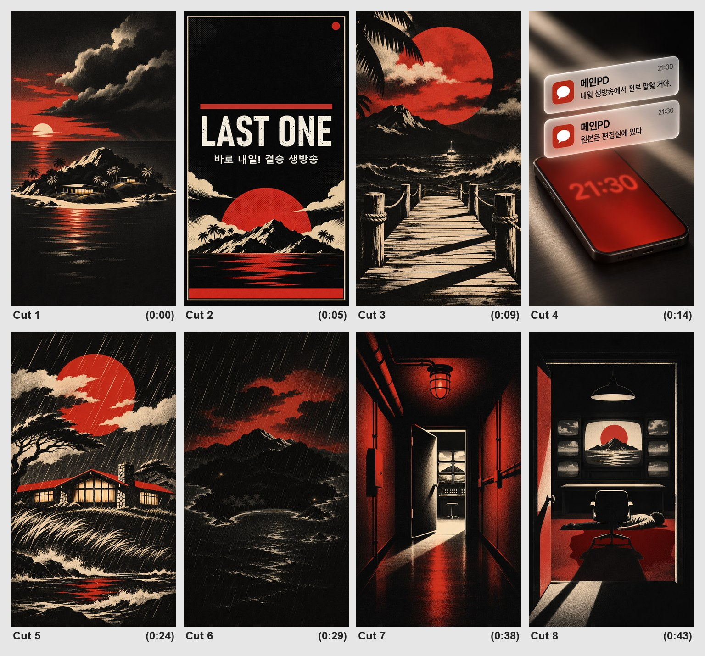

# V-01 오프닝 콘티 (방송 예고 → 단톡방 → 정전 → 발견)

> 이슈 #43. 초안, 지영 승인 전. 세로 9:16, 컷 8개, 생성본 51초 → 편집본 39.3초. 영상 안의 소리는 컷 프롬프트 안에 넣었다 (소리 프롬프트와 소리 표는 따로 없다). 규칙은 [RULES.md](../RULES.md)

## 1. 공통 스타일
모든 컷 프롬프트 맨 앞에 `{STYLE}`, 끝에 `{AVOID}` 와 `{NO-SOUND}` 를 그대로 붙여 쓴다. 색은 DESIGN.md 토큰(`--color-bg` `#0B0B0B`, `--color-text` `#F2EBDC`, `--color-primary` `#BF3026`)과 맞췄다. 그래픽 규칙 문서(#23)가 합쳐지면 그 문서에 맞춰 고친다.

**`{STYLE}`**
```
Mid-Century Graphic Noir, key art for a fictional island survival TV finale. Flat, high-contrast graphic shapes with fine film grain and a subtle halftone texture. Strict limited palette: near-black #0B0B0B, ivory #F2EBDC, and vermilion red #BF3026 as the only accent. Deep shadows, hard edge light, 1960s broadcast-graphic feel. Vertical 9:16 frame; keep important elements centered and let the edges fall into dark.
```

**`{AVOID}`** (화면)
```
Avoid: readable text, letters, numbers, captions, logos, watermarks, brand names, human faces, close-ups of people, trophy, award statue, hard drive, external drive, wound, violence, weapon, black baseball cap, walkie-talkie, citrus, any real broadcaster or messenger app interface.
```

**`{AVOID-T}`** (글자를 이미지에 넣는 컷 C-02, C-04용. `{AVOID}` 에서 글자 항목만 뺐다)
```
Avoid: any other text, letters or numbers than the quoted strings, logos, watermarks, brand names, human faces, close-ups of people, trophy, award statue, hard drive, external drive, wound, violence, weapon, black baseball cap, walkie-talkie, citrus, any real broadcaster or messenger app interface, any real phone brand design.
```

**`{NO-SOUND}`** (소리)
```
Audio avoid: voices, speech, lyrics, singing, melody, jingle, notification or message tone, typing sound, orchestral sting, breaker click, electrical zap, fluorescent light buzz, radio static, heartbeat, any real broadcaster or app sound. Keep all sound quiet and in the background.
```

**소리 기본 톤:** 낮고 성긴 어두운 드론 하나에 먼 파도와 바람. 멜로디, 박자, 음성은 없다. 종원의 앱 소리(OP-02, 04~08)가 먼저 들려야 하므로 영상 소리는 깔개로만 작게 둔다 (R-13). C-02와 C-04의 글자는 지영 결정으로 후편집이 아니라 이미지 안에 넣는다 (RULES R-08과 §5의 "후편집"과 다르다). 이 두 컷은 `{AVOID}` 대신 `{AVOID-T}` 를 쓴다. 나머지 컷에는 글자가 없다. C-04는 지영 요청으로 사진 같은 제품 샷이라 `{STYLE}` 대신 프롬프트 안에 팔레트만 적었다.

## 2. 컷 표
프롬프트 본문은 영어, 나머지는 한국어. 한 프롬프트에 한 컷, 한 동작이다. 길이는 도구가 허용하는 가장 가까운 값으로 만들고 후편집에서 맞춘다. 앱 자막은 영상에 굽지 않고 앱이 영상 아래에 보여 준다 (VQ-11). Higgsfield의 Seedance 2.5는 한 번에 최대 30초라서 A컷(C-01~C-04, 24초)과 B컷(C-05~C-08, 27초)으로 나눠 만든다. 합친 프롬프트는 이 표의 프롬프트를 시간순으로 이어 한 번만 쓴 것이다. 표의 "영상 입력"은 컷마다 따로 만들 때 넣는 시작·끝 프레임이다. 표의 시각은 편집본(`V-01_opening_v2.mp4`) 기준이고, 프롬프트 안의 초(5 seconds 등)는 생성할 때 길이다. 편집 내용은 3번의 편집 기록에 있다.

| 컷 | 시각 (길이) | 장면 | 앱 자막 | 프롬프트 (영상 + 소리) |
| --- | --- | --- | --- | --- |
| C-01 | 0:00~0:03 (3초) | 해 질 녘 무인도 전경. 낮은 건물 두 채에 불빛, 먼 수평선에 폭풍 구름. 사람과 배 없음. 영상 입력: 시작 프레임 스토리보드 Cut 1 | 상금 10억이 걸린 무인도 서바이벌, 「LAST ONE」. | `{STYLE} Slow aerial push-in over a small deserted island at dusk on a calm sea. A few warm lights glow from two low buildings. Dark storm clouds hang over the far horizon. No people, no boats. 5 seconds, 9:16. Audio: very quiet distant waves and a faint steady wind over a low, sparse dark drone pad with no melody. {AVOID} {NO-SOUND}` |
| C-02 | 0:03~0:07 (4초) | 방송 타이틀 카드(녹화 프레임). 얇은 아이보리 테두리, 모서리의 레드 REC 점, 아래쪽 붉은 해와 섬 실루엣, 맨 아래 레드 띠. 가운데에 제목과 같은 폭의 레드 띠, 방송 제목 「LAST ONE」, 한 줄 "바로 내일! 결승 생방송"을 넣는다 (영상에 필요한 글자, 지영 결정). 영상 입력: 시작 프레임 타이틀 없는 녹화 프레임(합성 전 원본), 끝 프레임 스토리보드 Cut 2 | 내일은 결승 생방송입니다. | `{STYLE} Broadcast title card styled as a recording frame: a thin ivory rectangular frame near the edges, a small vermilion record dot in the top-right corner, a near-black grainy field, and at the bottom a flat graphic red sun above a dark island silhouette on still water with a bold vermilion bar along the bottom edge. In the middle of the frame, a solid vermilion bar exactly as wide as the title, directly below it the show title "LAST ONE" in huge bold condensed sans-serif capitals, ivory, with a slightly distressed print texture, and beneath it one smaller line of Korean text in ivory: "바로 내일! 결승 생방송". The title block fades in with a subtle grain flicker while the frame and the scenery stay still. The only text is exactly the title "LAST ONE" and the Korean line "바로 내일! 결승 생방송". No people. 4 seconds, 9:16. Audio: the same low dark drone pad continues, the wind fades slightly, nothing else. {AVOID-T} {NO-SOUND}` |
| C-03 | 0:07~0:12 (5초) | 밤의 빈 선착장. 멀리 배 한 척의 불빛이 거친 바다로 멀어진다. 사람 없음. 영상 입력: 시작 프레임 스토리보드 Cut 3 | 폭풍이 몰아쳐 제작진의 배는 섬을 떠났습니다. | `{STYLE} Static wide shot of an empty wooden pier at night. The lights of a single boat recede into rough dark water in the distance while waves rise. No people on the pier. 5 seconds, 9:16. Audio: waves grow louder and the wind strengthens over the same low drone pad, with a very faint distant boat engine fading away. {AVOID} {NO-SOUND}` |
| C-04 | 0:12~0:20 (8초) | 어두운 책상 위에 비스듬히 놓인 가상 폰 하나(로고 없음)를 위에서 내려다보는 구도. 화면은 붉게 빛나고 큰 시각 "21:30"이 흐릿하게 보인다. 폰 위로 반투명한 흰 카드 두 개가 차례로 떠오른다. 카드마다 왼쪽에 레드 아이콘(말풍선 모양), 굵은 제목 "메인PD", 메시지, 오른쪽 위 시각 "21:30". 첫 카드 "내일 생방송에서 전부 말할 거야.", 둘째 카드 "원본은 편집실에 있다." (이어 읽으면 PRD §28.2의 한 줄과 같다). 글은 이미지 안에 넣는다. 손과 얼굴 없음. 영상 입력: 시작 프레임 카드 없는 같은 폰 이미지, 끝 프레임 스토리보드 Cut 4 | 결승 전날 밤, 메인 PD가 제작진 단톡방에 글을 남깁니다. | `Photorealistic product-shot render with a strict limited palette: near-black #0B0B0B, ivory #F2EBDC, and vermilion #BF3026 as the only accent. A generic dark smartphone with no logos, no brand marks and no notch lies at an angle on a dark desk, seen from slightly above in three-quarter perspective, as if looking down at the phone on the table. Soft diagonal beams of ivory light fall across the desk. The phone screen glows deep vermilion with a large soft blurred clock "21:30" on it. The first frosted-glass notification card rises out of the screen and floats above the phone, then a second card rises out and settles just below it, each stacked with a slight perspective tilt and a soft glow. Each card is a wide rounded rectangle in translucent frosted white. On the left of each card is a vermilion rounded-square icon with a simple white speech-bubble glyph, to its right a bold black title "메인PD" and below it the message in regular black text, and at the top right a small gray label "21:30". The first (upper) card message is "내일 생방송에서 전부 말할 거야." The second (lower) card message is "원본은 편집실에 있다." The only text is exactly the quoted strings. The camera slowly pushes in. No hands, no people. 10 seconds, 9:16. Audio: only the quiet drone pad and faint wind. No message tone and no typing sound. {AVOID-T} {NO-SOUND}` |
| C-05 | 0:20~0:25 (5초) | 폭풍 속 낮은 숙소 외관. 창마다 따뜻한 불빛, 비, 휘는 풀과 나무. 창 안에 사람 없음. 영상 입력: 시작 프레임 스토리보드 Cut 5 | 섬에 남은 사람들의 통신은 위성 전화 하나뿐입니다. | `{STYLE} Static exterior of a low lodge at night in a storm. Warm lit windows, rain streaks, wind bending tall grass and low trees. No people visible in the windows. 5 seconds, 9:16. Audio: wind and rain rise steadily with rustling grass over the same low drone pad. {AVOID} {NO-SOUND}` |
| C-06 | 0:25~0:29.5 (4.5초) | C-01과 같은 섬 전경, 밤, 폭우. 섬의 불이 거의 한꺼번에 꺼지고 희미한 불빛 두 점만 남는다. 영상 입력: 끝 프레임 스토리보드 Cut 6 (불이 거의 꺼진 모습) | 섬 전체가 정전됩니다. 위성 전화도 먹통이 됩니다. | `{STYLE} The same wide aerial view of the island at night in heavy rain. Nearly all the lights across the island go dark at once, leaving only two faint warm lights in near-total darkness. No people. 9 seconds, 9:16. Audio: when the lights go out the wind and waves drop out for 0.3 seconds, then return thinner and quieter over the same low drone pad, with one very quiet far-off thunder roll near the end. {AVOID} {NO-SOUND}` |
| C-07 | 0:29.5~0:31.5 (2초) | 좁은 어두운 복도. 레드 비상등이 켜지고, 복도 끝 문이 조금 열려 모니터 빛이 샌다. 사람 없음. 영상 입력: 시작 프레임 스토리보드 Cut 7 | 비상 전원이 들어옵니다. | `{STYLE} Slow forward dolly down a narrow dark corridor. A vermilion emergency light flickers on and holds steady. At the far end a door stands slightly open and pale monitor light spills out. No people. 5 seconds, 9:16. Audio: the low drone pad slowly rises in pitch with faint wind underneath, no buzzing of lights. {AVOID} {NO-SOUND}` |
| C-08 | 0:31.5~0:39.3 (7.8초) | 어두운 편집실 문 앞에서 본 먼 샷. 꺼지다시피 한 모니터의 희미한 빛, 의자 뒤 바닥에 쓰러진 사람의 뒷모습(얼굴 없음, 상처 없음). 사람 아래 바닥으로 바닥보다 더 짙은 붉은 액체가 퍼져 있다 (지영 요청). 책상 위는 비어 있다. 암전으로 끝난다. 영상 입력: 시작 프레임 액체 합성 전 원본, 끝 프레임 스토리보드 Cut 8 | 편집실에서 메인 PD가 쓰러진 채 발견됩니다. | `{STYLE} Static far shot from the doorway of a dim editing room. Rows of nearly dark monitors give off a faint glow. Behind an office chair a person lies still on the floor, seen only from behind at a distance, face turned away, no visible injury. A pool of deep dark crimson liquid, darker than the red floor, slowly spreads out across the floor beneath the person. The desk is empty. No shelves, no awards, no drives. The image slowly fades to black. 8 seconds, 9:16. Audio: the drone pad swells slowly, uneasy but quiet, and cuts to complete silence on the last frame. {AVOID} {NO-SOUND}` |

## 3. 스토리보드


칸 그림은 각 컷 프롬프트에서 소리와 길이를 뺀 첫 프레임이다. 컷 번호와 시작 시각 글자는 모델이 그리지 않고 합칠 때 얹었다.

- 기록: Higgsfield, GPT Image 2.6 (`gpt_image_2_6`), 화질 medium, 1k, 9:16. 8장을 한 번씩 만들고, Cut 2와 Cut 4는 지영 요청(글자를 이미지에 넣기)으로 한 번 더 만들었고, Cut 4는 구도와 말풍선을 바꿔 달라는 요청으로 또 한 번 만들었고, Cut 4의 시작 프레임(카드만 지운 같은 폰 이미지, 시트에는 넣지 않음)을 한 장 더 만들었다 (총 12장). 쓴 크레딧은 견적 기준 약 12 (장당 1). 시드는 도구가 알려 주지 않았다. 프롬프트는 2번 표의 `{STYLE}` + 장면 + `{AVOID}` (Cut 2, 4는 `{AVOID-T}`, Cut 4는 `{STYLE}` 대신 프롬프트에 팔레트를 직접 적음), 소리와 길이 문장은 뺐고 Cut 6은 "불이 거의 다 꺼진 순간"으로 바꿨다
- 영상 생성 기록 (2026-11-26): Higgsfield, Seedance 2.5 (`seedance_2_5`), 모드 `omni_reference`, 9:16, 480p(480×854), 24fps, 소리 생성 켬, 시드는 알려 주지 않음. A컷 24초(C-01~C-04) 72 크레딧, B컷 27초(C-05~C-08) 81 크레딧. 입력은 컷 표의 "영상 입력"과 같은 이미지(A: 시작 Cut 1, 참조 Cut 2·3·4 시작, 끝 Cut 4 / B: 시작 Cut 5, 참조 Cut 6·7·8 원본, 끝 Cut 8). A컷은 입력 필터가 C-01의 "A dark storm front gathers on the far horizon." 한 문장을 걸러서 "Dark storm clouds hang over the far horizon."으로 바꿨고, 합친 A 프롬프트의 Avoid에서 이 컷에 필요 없는 위험 단어(wound, violence, weapon 등)를 뺐다. 샘플 프레임에서 워터마크는 보이지 않았다
- 편집 기록 (2026-11-26, 지영 요청, ffmpeg, 크레딧 0): 합본 `V-01_opening_v1.mp4`(51.08초)를 `V-01_opening_v2.mp4`(39.33초, 480×854, 24fps, 소리 포함, 5.9MB)로 고쳤다. ① C-01 섬 확대를 3초 안에 끝나게 약 1.67배속(0:00~0:05 → 0:00~0:03) ② C-04 가운데 3초(원본 0:20~0:23)를 1초로 3배속 압축 ③ C-06은 불이 꺼진 순간(0:32, 원본 시각)부터 1.5초만 어둠을 두고 끊어서 복도로 넘김 ④ C-07 복도 전체 5.6초를 2초로 약 2.8배속 압축. ③의 정전 소리는 묵직한 스위치 끄는 소리로 바꿨다 (ffmpeg로 합성한 쿵 + 기계 딸깍 + 전원 내려가는 낮은 웅웅임, 불이 꺼지기 시작하는 0:27.04에 얹음, 순간 크기 −12dB, 파일 `V-01_switch-off_fx.wav`). 소리와 영상은 컷 경계에서 15ms 페이드로 이었다. 편집본은 [V-01_opening_v2.mp4](V-01_opening_v2.mp4)로 레포에 올렸다 (검토용 480p, 이 한 개만. 합본 v1, A·B 조각, 포스터, 스위치 소리 파일은 로컬에만 있다). 이 스위치 소리는 종원의 OP-05(차단기 탁 + 전기 꺼지는 소리, 같은 자리)와 같은 종류라 겹치면 어느 쪽을 쓸지 정해야 한다 (R-13)
- 시트에 쓴 Cut 2와 Cut 8은 모델로 다시 만든 것이 아니라 첫 생성본을 직접 고친 것이다. Cut 2는 녹화 프레임 그대로에 가운데 타이틀 묶음(제목과 같은 폭의 레드 띠, "LAST ONE", "바로 내일! 결승 생방송")을 합성했고 (폰트 Bahnschrift Bold Condensed, 맑은 고딕 Bold), Cut 8은 사람 아래 붉은 바닥에만 더 짙은 붉은 액체를 합성했다. 바뀐 곳 밖은 원본 픽셀 그대로다. Cut 2의 두 번째 생성본은 쓰지 않았다
- Cut 4의 글자는 이미지에 그대로 나왔다: "메인PD"(카드마다), "21:30"(폰 화면과 카드 두 개), "내일 생방송에서 전부 말할 거야.", "원본은 편집실에 있다." 방 이름 "LAST ONE 제작진"은 새 카드 모양에 자리가 없어 뺐다. Cut 2의 글자는 합성이다. 글자가 영상에서도 그대로 나올지는 영상을 만들어 봐야 안다
- 승인 때 볼 것: Cut 7 왼쪽 벽의 상자가 차단기함처럼 보인다 (R-01, 21:50 차단기). Cut 8의 짙은 붉은 액체는 피로 읽힌다 (RULES R-10은 피를 보여 주지 않는다고 하지만 지영 요청으로 넣었다). Cut 8 쓰러진 사람의 머리카락이 그려졌다 (R-04). Cut 1~3, 6에 야자나무가 있는데 시나리오에 없는 배경이다 (R-04). Cut 4는 사진 같은 제품 샷이라 다른 컷의 그래픽 스타일과 결이 다르고, 폰과 카드가 참고 이미지를 따라 실제 기기와 앱처럼 보일 수 있다 (R-06). 나머지 화면에 얼굴, 트로피, 하드디스크는 없다
