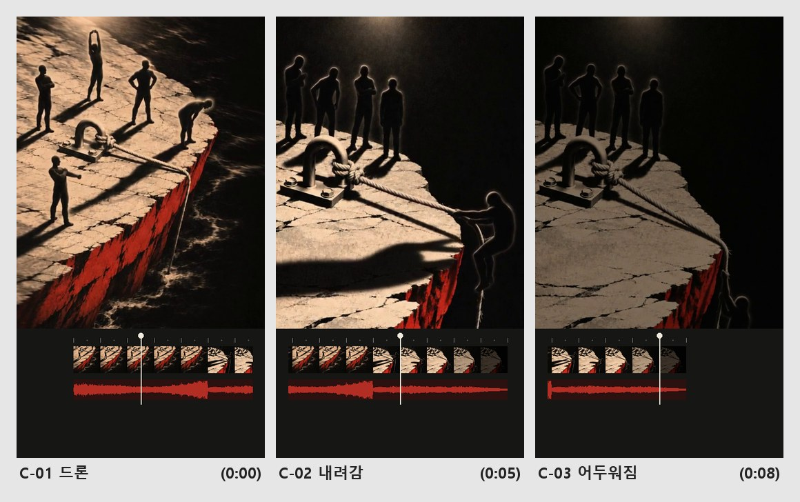

# V-02 R2 편집본 콘티

> 이슈 #78. 세로 9:16, 10초, 컷 3개. 스토리보드 지영 승인. 480p 검토 영상 있음. 규칙은 [RULES.md](../RULES.md)
> 쓰이는 곳: S-09 R2 "현재 · 편집실"에서 플레이어가 보는 방송 편집본 (§28.9). 공용 영상, 방장 폰만 소리 (VQ-7). 변형 1개, 범인 중립 (VQ-2). **R3 단서 문장이 아직 TODO라 V-03과 함께 초안이다 (VQ-23)**
> 무엇을 보여 주나: **방송에 나간 최종 화면**이다. 절벽 위에 선 출연진을 드론으로 찍듯 왼쪽에서 오른쪽으로 빠르게 훑으며 방송 테두리와 미션 타이틀 「CLIFF ROPE」가 떠서 방송 화면임을 알린다 → 출연진이 지켜보는 가운데 한 명이 로프를 잡고 절벽 아래로 내려가는 장면([V-09](V-09.md) C-03과 같은 촬영분) → 페이드 아웃해 검은 화면 → 앱이 "한서진, 개인 사정으로 자진 하차"를 보여 준다. 같은 밤을 방송용으로 편집해서 그림자가 다가오는 장면, 로프를 바꾸는 장면, 로프가 끊어지는 장면은 잘려 없다 (VQ-24)
> 글자: 미션 타이틀 「CLIFF ROPE」(아이보리 굵은 대문자, 점 없이 매끈하게)와 부제 "절벽 끝, 한 줄의 사투"는 방송 그래픽이라 영상 안에 넣되, 모델이 그리면 깨지므로 편집으로 얹는다 (RULES §5, R-08). 지영이 보낸 시안 모양을 따르고, 시안 그림에 생성 도구 표시가 있어 그림 자체는 쓰지 않는다 (R-12). 왼쪽 위 「LAST ONE」 로고는 넣지 않는다 (지영). 실제 방송사 그래픽과 닮지 않게 하고 (R-06), #23 그래픽 규칙(상경)과 맞춘다
> 화면과 사람: V-09와 같은 절벽, 같은 U자 고정 고리, 같은 색(`{COLOR-N}`)이지만 방송용으로 다듬은 화면이다 (녹화 표시 없음, 얇은 아이보리 테두리). 하늘의 해와 먼 섬 없음, 조명 기구 없음. 출연진은 남녀와 체형을 구별할 수 없는 검은 그림자 형체 (R-01, R-02)
> 소리: R2 내내 종원의 R2-02(편집실 모니터 웅 소리, 창밖 비)가 깔리므로 영상에는 웅 소리와 빗소리를 넣지 않고 잔잔한 밤바람만 작게 낸다 (R-13). 드론 컷은 카메라가 지나가는 바람 소리만 짧게, 프로펠러와 모터 소리는 없다

## 1. 공통 스타일
[V-01.md](V-01.md) 1번의 `{STYLE}`, `{AVOID}` 와 [V-09.md](V-09.md)의 `{COLOR-N}` 을 쓴다. 로고와 타이틀은 편집으로 얹는다. 소리 금지는 드론 컷만 `{NO-SOUND-D}`, 나머지는 V-09의 `{NO-SOUND-P}` 를 쓴다. Higgsfield 프롬프트는 필터에 걸릴 만한 말을 돌려 쓴다.

**`{NO-SOUND-D}`** (C-01 드론 컷. `{NO-SOUND-P}` 에 프로펠러, 모터, 비 소리를 더했다)
```
Audio avoid: voices, speech, scream, shouting, crying, breathing, lyrics, singing, melody, piano, music, jingle, notification or message tone, orchestral sting, impact, thud, crash, heartbeat, radio static, crackle, walkie-talkie, beep, propeller, drone motor, engine, rain, any real broadcaster or app sound. Keep all sound quiet and in the background.
```

## 2. 컷 표

| 컷 | 시각 (길이) | 장면 | 앱 자막 | 프롬프트 (영상 + 소리) |
| --- | --- | --- | --- | --- |
| C-01 | 0:00~0:05 (5초) | 방송 화면. 드론이 높은 곳에서 아래를 내려다보며 밤 절벽 위를 **왼쪽에서 오른쪽으로 빠르게 훑고 지나간다.** 절벽 위에 출연진(검은 그림자 형체 여럿)이 흩어져 서 있고 **각자 자유롭게 다른 행동을 한다**: 팔짱을 끼고 서 있거나, 두 팔을 위로 쭉 뻗어 몸을 풀거나, 허리에 손을 얹거나, 몸을 숙여 절벽 아래 바다를 내려다보거나, 한쪽 팔을 다른 손으로 가슴 앞으로 당겨 천천히 스트레칭한다. 모두 천천히 조금씩만 움직이고 팔을 빠르게 흔들지 않는다. 같은 U자 고리와 로프가 지나가고 절벽 아래로 어두운 바다와 흰 물결이 보인다. 이때 화면 아래쪽 「CLIFF ROPE」와 부제 "절벽 끝, 한 줄의 사투"가 뜬다 (편집으로 얹음). 영상 입력: 시작 프레임 스토리보드 Cut 1 (V-09 그림을 참조로 넣어 같은 절벽, 고리, 색으로 만든다) | 없음 (타이틀은 영상 안 방송 그래픽) | `{STYLE} {COLOR-N} Polished TV broadcast aerial footage at night, as if from a drone: the camera, high above and angled down toward a rocky cliff top and the dark sea far below, sweeps quickly from left to right. Several featureless black shadow figures stand spread out on the cliff top, each doing something different: one with arms crossed, one stretching both arms up overhead, one with hands on hips, one leaning forward to look down at the sea, one slowly pulling one straight arm across its chest with the other hand in a calm warm-up stretch. Everyone moves slowly and only a little; no fast or flapping motion, no motion blur on the figures. The same U-shaped metal anchor bolt and rope pass by. Soft blurred edges, no faces, no hair, no clothing details, no caps, nobody limping. Hard white light from above; no lamp or light fixture in view, no sky, no sun, no moon, no island. No text. 5 seconds, 9:16. Audio: a quick rush of wind as the camera passes, distant waves below, no melody. {AVOID} {NO-SOUND-D}` |
| C-02 | 0:05~0:08 (3초) | 출연진(검은 그림자 형체)이 고리 뒤에 서서 조금씩 움직이며(천천히 박수, 허리에 손, 팔짱) 지켜보고, 한 명이 로프를 잡고 절벽 아래로 내려가는 미션 장면 (V-09 C-03과 같은 촬영분을 방송용으로 다듬음). 방송 테두리만 있다 | 없음 | 생성 없음. V-09 C-03~C-04 영상의 0~3.0초(빠드드득 전)를 쓰고, 방송 테두리를 얹는다 (녹화 표시가 없는 원본이라 지울 것이 없다) |
| C-03 | 0:08~0:10 (2초) | 같은 화면이 페이드 아웃하며 완전히 검게 된다 | 화면이 검게 된 뒤 영상 아래에 앱이 보여 주는 글: "한서진, 개인 사정으로 자진 하차" (§28.4 공식 발표, 문구는 정연, 상경과 맞춘다) | 생성 없음. 마지막 프레임을 이어 붙이고 2초 동안 영상과 소리를 페이드 아웃한다 |

## 3. 스토리보드


C-01은 드론 컷 그림(GPT Image 2.6, V-09 그림을 참조로 넣어 같은 절벽, 고리, 색으로 만듦)에 방송 테두리, 「CLIFF ROPE」와 부제를 얹은 것이다. C-02는 V-09 C-03 그림에 방송 테두리를 얹은 것, C-03은 같은 화면이 거의 검게 된 페이드 아웃 끝이다. 글자는 Impact, 맑은 고딕 굵게이다.

- 영상: C-01만 Higgsfield Seedance 2.5 (`seedance_2_5`), 모드 `omni_reference`, 9:16, 480p, 24fps, 소리 생성 켬, 5초, 15 크레딧으로 만들었다 (시작 프레임 = 스토리보드 Cut 1 드론 그림, 프롬프트는 로컬 `_higgsfield-input/V-02/prompt_c01_drone.txt`). C-02는 V-09 C-03~C-04 영상 0~3.0초를 그대로 쓰고, C-03은 그 마지막 프레임을 2초 이어 붙였다 (생성 없음)
- 편집: 방송 테두리(로컬 `_higgsfield-input/V-02/broadcast_frame.png`)는 처음부터 끝까지, 「CLIFF ROPE」와 부제(같은 폴더 `broadcast_title.png`, 아래쪽 어둡게 포함)는 C-01에서만 0.6초부터 나타나 4.7초부터 사라진다. 8초부터 2초 동안 화면과 소리를 페이드 아웃해 검게 끝난다. 소리는 드론 컷 바람, C-02 바람과 로프 소리를 잇고, 끊어지는 소리가 들어가지 않게 C-02 뒤를 같은 영상 앞부분의 바람으로 이었다. 결과 [v-02.mp4](../../../public/videos/v-02.mp4) (10.0초, 0.99MB)
- 영상 확인 (0.5초 간격 프레임): C-01은 화면이 오른쪽으로 훑고, 출연진 다섯이 팔짱, 두 팔 위로 뻗기, 허리에 손, 몸 숙여 바다 내려다보기, 팔을 앞으로 뻗는 스트레칭을 각자 천천히 한다. 팔을 빠르게 흔들거나 번져 보이는 형체, 다리를 저는 형체는 없다. C-02는 V-09와 같은 크림색 윗면, 빨간 옆면에서 출연진 넷이 고리 뒤 제자리에서 조금씩 움직이고(박수, 허리에 손, 팔짱) 한 명이 절벽 아래로 내려가며, C-03에서 그대로 어두워진다. 로프가 끊어지는 장면과 녹화 표시는 없다. 소리 최대 −20.9dBFS, 평균 −40dB. 소리는 측정만 했다
- 글 대체 문구: 방송 화면에 드론이 절벽 위 출연진을 훑으며 「CLIFF ROPE」 미션 타이틀이 뜨고, 출연진 한 명이 로프를 잡고 절벽 아래로 내려가다 화면이 어두워진다 (R-09)
- 참고 자료 (로컬, 레포에 없음): `_higgsfield-input/V-02/last_one_logo_ref.png`(로고 시안), `_higgsfield-input/V-02/cliff_rope_title_ref.webp`(미션 타이틀 시안)
- 남은 확인: 드론 컷 출연진의 행동이 특정 인물의 특징(다리 저는 걸음 등)처럼 보이지 않는지, 형체가 근육질이라 남자처럼 보이지 않는지 (R-01, R-02). 타이틀 모양을 상경의 #23 그래픽 규칙과 맞출지. 길이 10초는 제안이다 (VQ-25)
