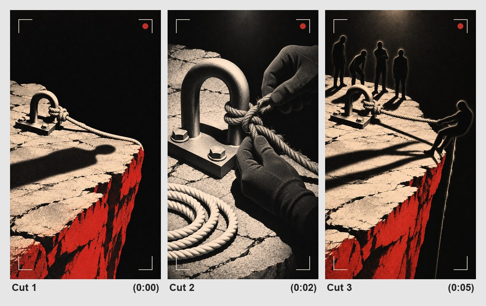

# V-03 R3 원본 영상 (CCTV) 콘티

> 이슈 #78. 세로 9:16, 7.8초, 컷 3개. 스토리보드 지영 승인. 480p 검토 영상 있음. 규칙은 [RULES.md](../RULES.md)
> 쓰이는 곳: S-09 R3 "과거 · 원본 영상 속 그날 밤" (§28.9). 공용 영상, 방장 폰만 소리 (VQ-7). 변형 1개, 범인 중립 (VQ-2). 범인별 단서는 앱이 R3 단서 글(`c-r3-01~04`)로 얹는다. **R3 단서 문장이 아직 TODO라 초안이다. 정연이 채우면 맞춰 고친다 (VQ-2, VQ-23)**
> 무엇을 보여 주나: 절벽을 향해 설치된 카메라의 원본으로, 제작진이 떠난 빈 절벽에 누군가의 그림자가 다가오고 → 장갑 낀 손이 로프를 낡은 것으로 바꾸고 → 출연진이 모여 로프에 매달리는 데까지 보여 준다. C-01과 C-03은 [V-09](V-09.md)와 같은 촬영분이고, C-02는 같은 카메라가 고정 고리로 줌인한 손 클로즈업이다. 로프를 바꾼 사람의 형체는 보이지 않고 손만 보인다. 로프가 풀리는 장면(V-09 C-04)은 보여 주지 않는다 (VQ-22)
> 반전: R3에서 "사고가 아니라 누군가 로프를 바꿨다"가 드러난다. [V-02](V-02.md)(R2 편집본)에는 그림자가 다가오는 장면과 로프를 바꾸는 장면이 잘려 없고 이 원본에는 남아 있어서, "편집본에서 잘린 장면이 있었다"는 반전이 된다 (§28.9, VQ-24)
> 화면과 사람: V-09와 같다 (같은 카메라, 녹화 표시, 글자와 숫자 없음, 하늘의 해와 먼 섬 없음, 위에서 떨어지는 빛, `{COLOR-N}` 색). 사람은 특징 없는 검은 그림자 형체이고, C-02의 손은 무늬 없는 작업 장갑만 보인다 (R-01, R-02)
> 소리: R3 시작 때 종원의 R3-01(테이프 되감기와 녹화 "삐")이, R3 내내 R3-02(오래된 영상 잡음)가 나오므로 영상에는 삐 소리, 지직거림, 되감기 소리, 영상 잡음을 넣지 않는다 (R-13)

## 1. 공통 스타일
[V-01.md](V-01.md) 1번의 `{STYLE}`, `{AVOID}` 와 [V-09.md](V-09.md)의 `{COLOR-N}` 을 쓴다. 녹화 표시는 편집으로 얹는다. 손 클로즈업인 C-02는 `{AVOID}` 대신 `{AVOID-H}` 를 쓴다.

**`{AVOID-H}`** (C-02. 손 말고 몸과 옷, 손의 특징을 막는다)
```
Avoid: any text, letters or numbers, logos, watermarks, faces, visible body or clothing beyond the gloved hands, rings, watch, tattoo, sleeve pattern, red stains, sky, lamp.
```

**`{NO-SOUND-R}`** (R3용. V-09의 `{NO-SOUND-P}` 에 R3-01, R3-02와 같은 종류의 소리를 더했다)
```
Audio avoid: voices, speech, scream, shouting, crying, breathing, lyrics, singing, melody, piano, music, jingle, notification or message tone, orchestral sting, impact, thud, crash, heartbeat, radio static, crackle, walkie-talkie, beep, tape rewind, tape hiss, video noise, any real broadcaster or app sound. Keep all sound quiet and in the background.
```

**소리 기본 톤:** 밤바람과 먼 파도, 바위 위 작은 발소리, 로프 스치는 소리. 멜로디, 음성, 삐 소리, 잡음은 없다.

## 2. 컷 표

| 컷 | 시각 (길이) | 장면 | 앱 자막 | 프롬프트 (영상 + 소리) |
| --- | --- | --- | --- | --- |
| C-01 | 0:00~0:02 (2.3초) | V-09 C-01과 같다. 밤, 제작진이 떠난 빈 절벽 위. U자 고정 고리에 새 아이보리 로프. 누군가의 사람 그림자(머리, 어깨)가 왼쪽에서 바위 위로 들어와 로프 쪽으로 다가온다 | 없음 (R3 단서 글은 앱이 따로 보여 준다) | V-09의 C-01~C-02 영상 0~2.29초(그림자가 드리워지고 형체가 들어오기 전까지)를 쓴다. 그림자의 주인이 걸어 들어오는 V-09 C-02는 쓰지 않는다 |
| C-02 | 0:02~0:05 (3초) | 화면이 잠깐 끊겼다 이어진다. 같은 카메라가 고정 고리로 줌인한다. 무늬 없는 어두운 작업 장갑을 낀 두 손이 새 아이보리 로프를 풀어 내고 해진 낡은 회색 로프를 대신 묶는다. 손만 보인다 | 없음 | `{STYLE} {COLOR-N} Raw footage from a fixed camera zoomed in close on a night cliff top. Close on the same U-shaped metal anchor bolt on the cracked rock top: two hands in plain dark work gloves finish tying an old frayed gray rope with worn fibers to the anchor and pull the knot tight, while the fresh ivory twisted rope lies coiled beside them. Only the gloved hands are visible. The camera stays still. No text. 4 seconds, 9:16. Audio: a cold night wind, distant waves, the rustle of rope fibers and a soft tug as the knot is pulled tight, no melody. {AVOID-H} {NO-SOUND-R}` (4초로 만들어 0.5~3.5초를 쓴다) |
| C-03 | 0:05~0:08 (2.5초) | V-09 C-03과 같다. 다시 끊겼다 이어진다. 출연진(검은 그림자 형체)이 모여 한 명씩 로프에 매달려 절벽 아래로 내려간다. 여기서 끝난다 | 없음 | V-09의 C-03~C-04 영상 0~2.5초(출연진이 서 있고 한 명이 로프를 잡고 절벽 아래로 내려가는 데까지)를 쓴다 |

## 3. 스토리보드


C-01과 C-03은 V-09 그림, C-02는 C-01과 같은 U자 고리로 만든 손 클로즈업 그림이다 (GPT Image 2.6). 녹화 표시와 컷 번호, 시작 시각 글자는 합칠 때 얹었다.

- 영상: C-01과 C-03은 V-09 영상에서 잘라 쓰고, C-02만 Higgsfield Seedance 2.5 (`omni_reference`, 9:16, 480p, 소리 생성 켬)로 4초를 만들어 0.5~3.5초를 썼다 (12 크레딧, 시작 프레임 = 손 클로즈업 그림). 클립 프롬프트는 로컬 `_higgsfield-input/V-03/prompt_c02.txt`
- 편집: V-09의 C-01~C-02 영상 0~2.29초, 손 클로즈업 0.5~3.5초, V-09의 C-03~C-04 영상 0~2.5초를 이어 붙이고 V-09와 같은 녹화 표시를 한 번에 얹었다 (컷이 바뀌어도 표시가 움직이지 않는다). 2.21초와 5.21초에 검은 4프레임 깜빡임. 손 클로즈업은 생성 없이 ffmpeg로 앞뒤 컷과 색을 맞췄다: 무채색으로 만든 뒤(`hue=s=0`) V-09 영상의 크림색 윗면과 검은 배경에서 잰 밝기별 색으로 칠하고, 회색 바위(밝기 120~200)를 크림색 밝기(160~240)로 올렸다 (`curves`, 값은 로컬 `_higgsfield-input/V-03/color/curves_bright.txt`). 장갑과 배경은 어둡게 둔다. 결과 [V-03_raw_v1.mp4](V-03_raw_v1.mp4) (7.79초, 0.90MB, RULES §3 검토용 예외)
- 영상 확인 (0.5초 간격 프레임): 그림자가 왼쪽에서 들어오고 형체는 보이지 않는다 → 손 클로즈업이 같은 U자 고리와 로프, 같은 크림색 세피아 톤으로 이어진다 → 출연진이 서 있고 한 명이 로프를 잡고 절벽 아래로 내려가는 데서 끝난다. 로프에는 한 명만 있고, 달려가는 출연진과 로프가 끊어지는 장면은 없다. 소리 최대 −12.4dBFS, 평균 −40dB. 소리는 측정만 했다
- 글 대체 문구: 절벽을 찍던 카메라 앞에 누군가의 그림자가 다가온 뒤 장갑 낀 손이 로프를 낡은 것으로 바꿔 묶고, 이어 출연진이 모여 로프에 매달린다 (R-09)
- 남은 확인: 스토리보드 Cut 2 그림은 색을 맞추기 전 회색 그대로다. R3에서 바꿔치기가 드러나는 것이 R3 단서 글(정연)과 맞는지 (VQ-22, VQ-23). 길이 7.8초는 제안이다 (VQ-25)
