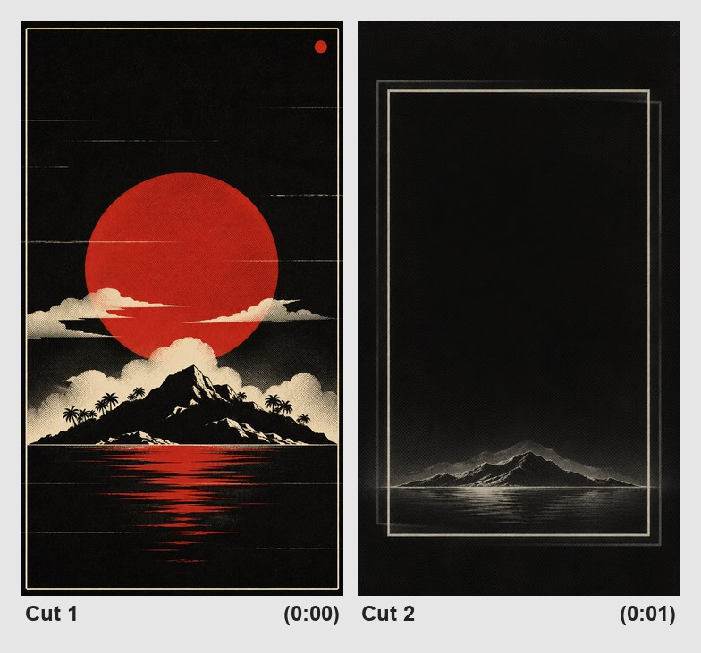

# V-04 유령 전환 콘티

> 이슈 #62. 초안, 지영 승인 전. 세로 9:16, 2초, 컷 2개. 영상 안의 소리는 컷 프롬프트 안에 넣었다 (소리 프롬프트와 소리 표는 따로 없다). 규칙은 [RULES.md](../RULES.md)
> 쓰이는 곳: S-10 유령 모드. R2가 시작될 때 **희생자 폰에서만** 나온다 (FR-050). 나머지 폰은 영상이 아니라 앱의 긴급 속보 화면이다. 변형 1개, 범인과 무관하다 (R-02)
> 주의: 유령 모드로 넘어간 뒤 보이는 "범인의 흐릿한 특징"은 앱의 몫이고 영상에는 넣지 않는다 (R-01). 쓰러진 모습이나 습격은 보여 주지 않고 (R-10), 희생자의 얼굴과 이름도 없다. 종원의 GH-01(REC 꺼지는 소리 + 지직)이 같은 때 나오므로 영상 소리는 그 밑에 깔리는 작은 소리만 낸다 (R-13)
> 길이: AC-050이 R2가 시작되면 2초 안에 유령 모드가 뜬다고 해서 영상도 2초로 한다 (VQ-18). Seedance 2.5는 4초부터 만들 수 있어 4초로 만들어 2배속으로 줄인다

## 1. 공통 스타일
[V-01.md](V-01.md) 1번의 `{STYLE}`, `{AVOID}` 를 그대로 쓴다. 소리 금지는 유령 연출(V-04, V-05)에 같이 쓰는 `{NO-SOUND-G}` 를 쓴다.

**`{NO-SOUND-G}`** (V-01의 `{NO-SOUND}` 를 유령 연출에 맞게 바꿨다. 지직거림, 삑 소리, 속삭임, 숨소리는 종원의 GH-01~GH-04 몫이거나 범인의 특징(무전기 소리)과 닮았다)
```
Audio avoid: voices, speech, whispering, breathing, lyrics, singing, melody, jingle, notification or message tone, orchestral sting, beep, test tone, radio static, crackle, glitch noise, digital buzz, walkie-talkie, record-stop click, tape sound, loud roar or boom, heartbeat, any real broadcaster or app sound. Keep all sound quiet and in the background.
```

**소리 기본 톤:** 아주 작고 낮은 방 소리가 갑자기 얇아지며 끊기고, 먼 곳의 옅은 울림만 남았다가 사라진다. 지직거림, 삑 소리, 속삭임은 없다. 종원의 GH-01(희생자 폰)이 먼저 들려야 하므로 깔개로만 작게 둔다 (R-13). 글자는 영상에 넣지 않는다.

## 2. 컷 표
프롬프트 본문은 영어, 나머지는 한국어. 표의 시각은 편집본(2초) 기준이고, 프롬프트 안의 초는 생성할 때 길이다 (두 컷을 4초로 한 번에 만들어 2배속으로 줄인다). 시작 프레임 = 스토리보드 Cut 1, 끝 프레임 = Cut 2. 컷마다 따로 만들 때는 표의 "영상 입력"을 쓴다.

| 컷 | 시각 (길이) | 장면 | 앱 자막 | 프롬프트 (영상 + 소리) |
| --- | --- | --- | --- | --- |
| C-01 | 0:00~0:01 (1초, 생성 2초) | 방송 녹화 프레임. 얇은 아이보리 테두리, 어두운 바탕, 아래쪽에 붉은 해와 섬 실루엣, 모서리의 레드 REC 점. 화면이 가로 조각으로 갈라져 옆으로 어긋나고, 붉은 해가 색을 잃고 아이보리로 빠지며 REC 점이 꺼진다. 글자 없음. 영상 입력: 시작 프레임 스토리보드 Cut 1 | 없음 (유령 모드 화면과 범인의 흐릿한 특징은 앱 UI다) | `{STYLE} Broadcast recording frame: a thin ivory rectangular frame near the edges on a near-black grainy field, a flat red sun above a dark island silhouette on still water at the bottom, a small vermilion record dot in the top-right corner. The picture suddenly breaks into horizontal bands that shift sideways out of alignment like a bad video signal, the red sun fades to pale ivory, and the record dot switches off. No text. 2 seconds, 9:16. Audio: a very quiet low room tone that suddenly thins and stops, smooth and not crackling, nothing sharp. {AVOID} {NO-SOUND-G}` |
| C-02 | 0:01~0:02 (1초, 생성 2초) | 어긋난 화면이 옅은 아이보리 이중 윤곽으로 남아 유령처럼 흐릿하게 겹친다. 붉은색은 모두 사라지고 차갑게 바랜 색이다. 한가운데는 어둡게 비워 둔다(앱이 유령 모드 화면을 얹는 자리). 마지막은 아주 천천히 흔들리다 멈춘 프레임. 글자 없음, 사람 없음. 영상 입력: 끝 프레임 스토리보드 Cut 2 | 없음 | `{STYLE} The shifted picture settles into a pale double image like a faint afterimage: the same frame and island outline repeated as soft translucent ivory lines slightly offset from each other, no red at all, cool washed-out ivory and charcoal gray on near-black. The center of the frame is left empty and dark. The lines drift very slowly and then hold almost still on the last frame. No people, no text. 2 seconds, 9:16. Audio: a faint low airy tone lingers and slowly fades to near silence, smooth and not crackling, nothing sharp. {AVOID} {NO-SOUND-G}` |

## 3. 스토리보드


칸 그림은 각 컷 프롬프트에서 소리와 길이를 뺀 프레임이다 (Cut 2는 끝 프레임으로 쓴다). 컷 번호와 시작 시각 글자는 모델이 그리지 않고 합칠 때 얹었다.

- Cut 1 (0:00): 정상 방송 프레임. 아이보리 테두리, 붉은 해와 섬 실루엣, 모서리의 REC 점. 화면이 가로 조각으로 갈라져 어긋나기 시작한다
- Cut 2 (0:01): 붉은색이 없는 옅은 아이보리 이중 윤곽. 가운데는 어둡게 비어 있다
- 글 대체 문구: 녹화 화면이 끊기고 옅은 유령 윤곽만 남는다 (R-09)
- 기록 (2026-11-26): Cut 1은 새로 만들지 않고 V-07 Cut 1(섬, 붉은 해, REC 점) 이미지를 그대로 다시 썼다. Cut 2는 Higgsfield, GPT Image 2.6 (`gpt_image_2_6`), 화질 medium, 1k, 9:16으로 한 장 만들었다 (1 크레딧, 거래 내역 기준). 프롬프트는 C-02 프롬프트에서 움직임, 소리, 길이 문장을 빼고 `{STYLE}` + 장면 + `{AVOID}` 로 썼다. 시드는 도구가 알려 주지 않았다
- 영상 생성 기록 (2026-11-26, 지영 요청): Higgsfield, Seedance 2.5 (`seedance_2_5`), 모드 `omni_reference`, 9:16, 480p(480×854), 24fps, 소리 생성 켬, 4초, 12 크레딧 (거래 내역 기준). 시드는 알려 주지 않았다. 입력은 시작 프레임 Cut 1, 끝 프레임 Cut 2. 첫 요청은 Higgsfield 입력 필터가 거절해서(자동 환불) "tears into slices", "torn", "ghostly" 같은 말을 "breaks into bands", "afterimage"로 바꿔 다시 만들었다. 2번 표의 프롬프트는 바꾼 말이다
- 편집: 4초 원본을 2배속으로 줄여 2.0초로 만들었다 (`setpts=0.5`, `atempo=2.0`). 원본 첫 컷에 지직거리는 잡음이 섞여 있어서 (2kHz 위 소리 비율 22~48%, 뾰족한 정도를 나타내는 kurtosis 7~14로 측정) 1.2kHz 아래만 남기는 필터로 걸러냈다 (R-01, R-13). 결과 [V-04_ghost_v1.mp4](V-04_ghost_v1.mp4) (2.0초, 0.28MB)는 검토용으로 이 폴더에 올렸다 (RULES §3 예외, VQ-3). 4초 원본, 합친 프롬프트, 입력 이미지는 로컬 `_higgsfield-input/V-04/` 에만 있다
- 영상 확인: 컷 전환은 1.0초로 계획과 같다. C-01에서 붉은 해가 아이보리로 바래고 REC 점이 꺼지며, 0.85초쯤 가로 띠가 옆으로 어긋난다. C-02는 붉은색 없는 이중 윤곽이고 가운데가 비어 있다 (프레임 8개를 눈으로 봄). 소리는 −38~−24dB의 낮은 소리, 최대 −12dBFS이고, 걸러낸 뒤 2kHz 위 소리는 1% 아래다. 소리를 귀로 확인하지는 못했다
- 승인 때 볼 것: Cut 1에 야자나무와 구름이 있는데 시나리오에 없는 배경이다 (R-04, V-07과 같은 그림). V-07과 시작 그림이 같아 두 영상이 닮아 보일 수 있다 (둘 다 "방송 끊김"이 주제라 일부러 같은 말투로 했다). 영상 소리는 GH-01 밑에 깔리는 작은 소리고 지직거림이 없다 (R-01, R-13). 길이 2초는 AC-050 해석에 따른 제안이다 (VQ-18)
