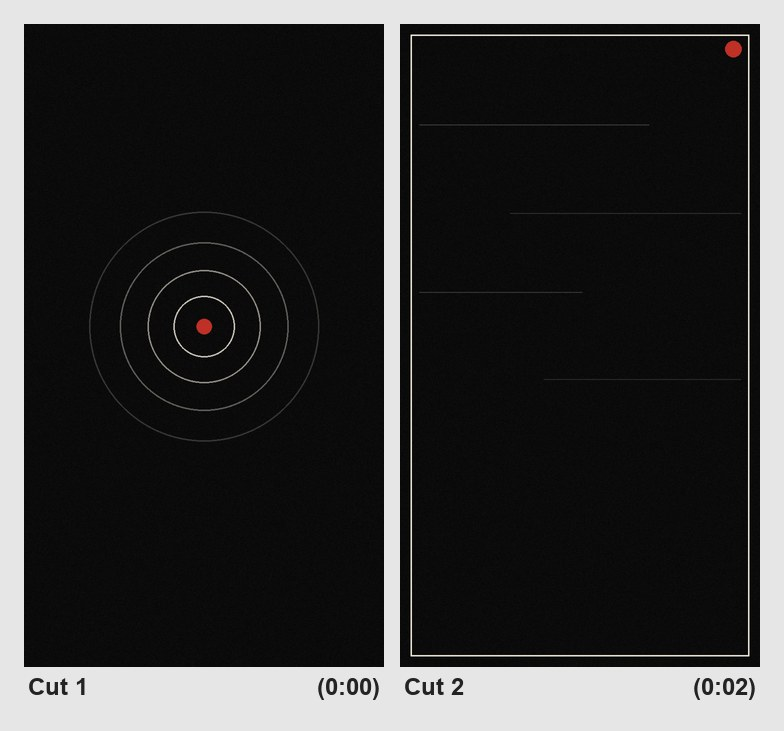

# V-05 출몰 "생방송 연결" 콘티

> 이슈 #62. 지영 승인 (2026-11-26). 세로 9:16, 4초, 컷 2개. 영상 안의 소리는 컷 프롬프트 안에 넣었다 (소리 프롬프트와 소리 표는 따로 없다). 규칙은 [RULES.md](../RULES.md)
> 쓰이는 곳: S-10 출몰. 유령이 출몰을 쓰면 **모든 폰**에 덮는 화면으로 나온다 (FR-053, 판 전체 1번 AC-053). 변형 1개, 범인과 무관하다 (R-02)
> 소리: 영상 소리도 **모든 폰이 같이 낸다** (지영 결정, 2026-11-26, VQ-19). 공용 영상은 방장 폰만 소리를 낸다는 sound.md 규칙 1의 예외이고, 종원의 GH-04(규칙 3)와 같은 방식이다. 폰마다 재생이 조금씩 어긋나도 티가 안 나게 날카로운 시작 없이 부드럽게 커졌다 작아지는 소리로 만든다
> 주의: 유령의 말(1~80자)은 판마다 달라서 영상에 굽지 않고 앱이 영상 아래에 보여 준다 (R-08). "생방송 연결" 글자도 앱이 보여 준다 (VQ-16 제안과 같다). 종원의 GH-04("생방송 연결" 지직 + 낮은 굉음, 3초)가 같은 때 나오므로 영상 소리는 그 밑에 깔리는 작은 소리만 낸다 (R-13). 길이 4초는 Seedance 2.5의 최소 길이이고, GH-04가 끝난 뒤에도 마지막 프레임이 잠깐 남는다

## 1. 공통 스타일
[V-01.md](V-01.md) 1번의 `{STYLE}`, `{AVOID}` 를 그대로 쓴다. 소리 금지는 [V-04.md](V-04.md)에서 정의한 `{NO-SOUND-G}` 를 쓴다 (유령 연출 공통).

**소리 기본 톤:** 낮고 부드러운 공기 소리가 서서히 커졌다가 낮은 지속음으로 열리고 부드럽게 사라진다. 모든 폰이 같이 내므로 탁, 쿵 같은 날카로운 시작점과 박자가 없다. 지직거림, 삑 소리, 굉음, 속삭임은 없다 (GH-04 몫). 글자는 영상에 넣지 않는다.

## 2. 컷 표
프롬프트 본문은 영어, 나머지는 한국어. 4초라서 두 컷을 한 번에 만든다 (시작 프레임 = 스토리보드 Cut 1, 끝 프레임 = Cut 2). 컷마다 따로 만들 때는 표의 "영상 입력"을 쓴다.

| 컷 | 시각 (길이) | 장면 | 앱 자막 | 프롬프트 (영상 + 소리) |
| --- | --- | --- | --- | --- |
| C-01 | 0:00~0:02 (2초) | 어두운 화면 한가운데에 작은 레드 점이 켜지고, 가는 아이보리 동심원이 바깥으로 천천히 퍼진다(신호를 찾는 모양). 가로 주사선 한 줄이 위에서 아래로 한 번 쓸고 지나간다. 글자 없음. 영상 입력: 시작 프레임 스토리보드 Cut 1 | 없음 | `{STYLE} Near-black grainy field. A single small vermilion dot switches on at the exact center and thin ivory concentric rings expand slowly outward from it like a signal searching, while one thin horizontal scan band sweeps once from top to bottom. No text. 2 seconds, 9:16. Audio: a soft low airy swell fades in slowly with no sharp start, smooth and not crackling, nothing sharp. {AVOID} {NO-SOUND-G}` |
| C-02 | 0:02~0:04 (2초) | 동심원이 가장자리까지 퍼져 사라지고, 얇은 아이보리 테두리와 모서리의 레드 REC 점이 있는 방송 화면이 켜진 채 멈춘다. 가운데는 어둡고 비어 있고, 아래쪽 3분의 1은 앱이 유령의 말을 보여 주는 빈 자리로 어두운 바탕을 그대로 둔다. 가는 주사선이 몇 줄 천천히 지나간다. 글자 없음, 사람 없음. 영상 입력: 끝 프레임 스토리보드 Cut 2 | 영상 아래에 앱이 보여 주는 글: "생방송 연결", 유령의 말 (1~80자, 판마다 다름, R-08) | `{STYLE} The rings reach the edges of the frame and fade out, and a thin ivory rectangular broadcast frame with a small vermilion record dot in the top-right corner switches on and holds. The middle of the frame is dark and empty, and the lower third stays plain near-black. A few faint scan lines drift slowly across the still frame. No people, no text. 2 seconds, 9:16. Audio: the airy swell opens into a gentle low sustained tone and fades out smoothly with no sharp ending, nothing sharp. {AVOID} {NO-SOUND-G}` |

## 3. 스토리보드

칸 그림은 각 컷 프롬프트에서 소리와 길이를 뺀 프레임이다 (Cut 2는 끝 프레임으로 쓴다). 컷 번호와 시작 시각 글자는 모델이 그리지 않고 합칠 때 얹었다.

- Cut 1 (0:00): 어두운 화면 한가운데의 작은 레드 점과 퍼지기 시작하는 아이보리 동심원
- Cut 2 (0:02): 아이보리 테두리와 REC 점이 있는 멈춘 방송 화면. 가운데는 비어 있고 아래 3분의 1은 어두운 빈 자리
- 글 대체 문구: 신호를 찾는 동심원이 퍼지고 방송 화면이 켜진다 (R-09)
- 기록 (2026-11-26): 두 칸 모두 파이썬으로 직접 그렸다 (DESIGN.md 토큰 색, 레포 밖 임시 스크립트). Cut 2는 Higgsfield, GPT Image 2.6 (`gpt_image_2_6`), 화질 medium, 1k, 9:16으로 한 장 만들었지만 (1 크레딧, 거래 내역 기준) 가운데에 붉은 해와 섬, 야자나무를 크게 그려서 "가운데는 비어 있다"와 맞지 않아 쓰지 않았다. 그 이미지는 레포에 없다. V-06 Cut 1 때와 같은 일이다 (모델이 빈 프레임을 잘 그리지 않는다)
- 영상 생성 기록 (2026-11-26, 지영 요청): Higgsfield, Seedance 2.5 (`seedance_2_5`), 모드 `omni_reference`, 9:16, 480p(480×854), 24fps, 소리 생성 켬, 4초, 12 크레딧 (거래 내역 기준). 시드는 알려 주지 않았다. 프롬프트는 컷 표를 시간순으로 이은 합친 프롬프트이고, 입력은 시작 프레임 Cut 1, 끝 프레임 Cut 2다
- 편집: 원본 소리가 첫 0.1초부터 가장 큰 크기(−21dB)로 시작해서, 모든 폰이 같이 낼 때 시작이 튀지 않게 소리에 0.4초 페이드인만 넣었다 (VQ-19). 영상은 손대지 않았다. 결과 [v-05.mp4](../../../public/videos/v-05.mp4) (4.04초, 0.28MB)는 `public/videos/` 에 있다 (VQ-3). 원본, 합친 프롬프트, 입력 이미지는 로컬 `_higgsfield-input/V-05/` 에만 있다
- 영상 확인: 컷 전환은 2.0초로 계획과 같다. C-01에서 동심원이 퍼지고 0.5초쯤 레드 점이 켜지며 주사선이 위에서 아래로 지나간다. C-02는 테두리와 REC 점만 있는 거의 멈춘 화면이고 가운데와 아래 3분의 1이 비어 있다 (프레임 10개를 눈으로 봄). 동심원이 가장자리까지 퍼져 사라지는 모습 없이 바로 컷으로 바뀐다. 소리는 낮은 지속음(가장 센 주파수 117Hz, 235Hz)이고, 2.0초 컷 전환에서 한 번 조금 커진다 (−23dB, 바탕은 −27dB). 2kHz 위 소리는 24% 이하이고 지직거림 같은 뾰족한 소리는 측정되지 않았다. Claude는 소리를 귀로 확인하지 못했고, 지영이 직접 들어 확인했다
- 승인 때 볼 것: 영상 소리를 모든 폰이 같이 내므로 폰마다 시작이 어긋나도 괜찮은 소리인지, GH-04와 같이 나가도 시끄럽지 않은지 (VQ-19, R-13). 유령의 말이 들어갈 아래 3분의 1이 비어 있는지 (R-08). 레드 REC 점은 V-01, V-06, V-07과 같은 모양이라 톤이 이어진다
- 승인 (2026-11-26, 지영): 소리를 직접 들어 확인했고, 동심원이 가장자리까지 퍼지지 않고 바로 컷으로 바뀌는 것도 보고 그대로 두기로 했다
