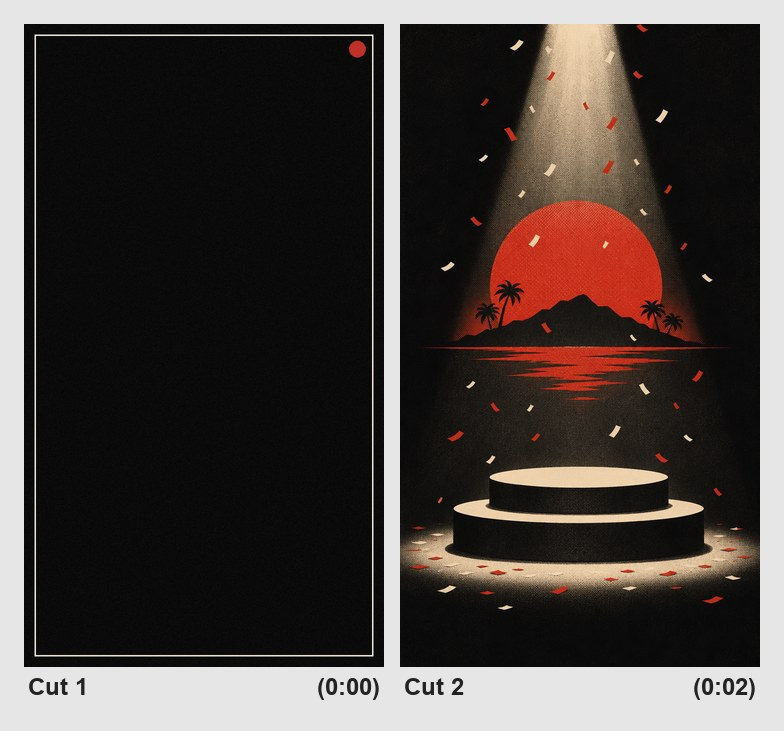

# V-06 엔딩 · 검거 성공 콘티

> 이슈 #51. 초안, 지영 승인 전. 세로 9:16, 5초, 컷 2개 (지영 요청으로 해가 뜨는 컷을 뺐다). 영상 안의 소리는 컷 프롬프트 안에 넣었다 (소리 프롬프트와 소리 표는 따로 없다). 규칙은 [RULES.md](../RULES.md)
> 쓰이는 곳: S-12 해설 카드 1 (엔딩). 변형 1개, 범인과 무관하다 (R-02). 주의: 우승자 발표라서 트로피를 떠올리기 쉽지만 **트로피는 범행 도구라 해설 카드 4에서 처음 공개된다 (R-11)**. 우승자 이름은 영상에 굽지 않고 앱이 채운다 (R-08). 팡파르는 종원의 RV-01 몫이다 (R-13)

## 1. 공통 스타일
[V-01.md](V-01.md) 1번의 `{STYLE}`, `{AVOID}` 를 그대로 쓴다 (V-06은 모든 컷이 같은 그래픽 스타일이다). 소리 금지는 엔딩용으로 늘린 `{NO-SOUND-E}` 를 쓴다.

**`{NO-SOUND-E}`** (V-01의 `{NO-SOUND}` 에 팡파르, 환호를 더했다)
```
Audio avoid: voices, speech, lyrics, singing, melody, fanfare, brass, trumpet, applause, cheering, crowd, jingle, notification or message tone, orchestral sting, any real broadcaster or app sound. Keep all sound quiet and in the background.
```

**소리 기본 톤:** 낮고 따뜻한 지속음 하나에 종이가 스치는 질감. 멜로디, 박자, 음성은 없다. 우승자 발표 팡파르(RV-01)는 종원의 앱 소리가 내므로 영상은 그 밑에 깔리는 작은 소리만 낸다 (R-13). 글자는 영상에 넣지 않는다.

## 2. 컷 표
프롬프트 본문은 영어, 나머지는 한국어. 5초라서 두 컷을 한 번에 만든다 (시작 프레임 = 스토리보드 Cut 1, 끝 프레임 = Cut 2). 컷마다 따로 만들 때는 표의 "영상 입력"을 쓴다.

| 컷 | 시각 (길이) | 장면 | 앱 자막 | 프롬프트 (영상 + 소리) |
| --- | --- | --- | --- | --- |
| C-01 | 0:00~0:02 (2초) | 방송 녹화 프레임. 어두운 바탕에 얇은 아이보리 테두리와 모서리의 작은 레드 REC 점. 점이 커져 화면 가운데의 큰 레드 원(방송 램프)이 켜지고 붉은 빛이 은은하게 퍼진다. 글자 없음. 영상 입력: 시작 프레임 스토리보드 Cut 1 | 없음 | `{STYLE} Broadcast recording frame: a thin ivory rectangular frame near the edges on a near-black grainy field, a small vermilion record dot in the top-right corner. The dot swells into a large vermilion circular lamp in the center of the frame and lights up with a soft red glow that spills slowly across the frame. No text. 2 seconds, 9:16. Audio: a soft warm sustained pad swells slowly with a faint electrical warmth, nothing sharp. {AVOID} {NO-SOUND-E}` |
| C-02 | 0:02~0:05 (3초) | 어두운 무대의 빈 연단. 위에서 내려오는 좁은 빛줄기가 비추고, 아이보리와 레드 색종이가 천천히 떨어진다. 연단 위는 완전히 비어 있다 (트로피 없음). 뒤의 그림 막에는 섬 실루엣과 붉은 해. 사람 없음. 마지막은 멈춘 프레임. 영상 입력: 끝 프레임 스토리보드 Cut 2 | 영상 아래에 앱이 보여 주는 글: "검거 성공", "우승자: ○○" (이름은 앱이 채운다, R-08) | `{STYLE} Static shot of an empty two-step podium on a dark stage, lit by a single narrow beam of light from above. Ivory and vermilion paper confetti slowly falls through the beam. Behind the podium a flat backdrop shows a dark island silhouette under a red sun. The top of the podium is completely bare, nothing stands on it. No people, no text. The shot settles and holds still on the last frame. 3 seconds, 9:16. Audio: the warm pad continues and opens into a gentle sustained tone with the soft rustle of falling paper, then fades out naturally, nothing sharp. {AVOID} {NO-SOUND-E}` |

## 3. 스토리보드


칸 그림은 각 컷 프롬프트에서 소리와 길이를 뺀 프레임이다 (Cut 2는 끝 프레임으로 쓴다). 컷 번호와 시작 시각 글자는 모델이 그리지 않고 합칠 때 얹었다.

- 기록: Higgsfield, GPT Image 2.6 (`gpt_image_2_6`), 화질 medium, 1k, 9:16. V-06과 V-07 컷 3장씩 6장을 한 번씩 만들었다 (견적 기준 약 6 크레딧, 장당 1). V-06은 해가 뜨는 컷(옛 Cut 3)을 빼서 그 그림 한 장은 쓰지 않았다. 프롬프트는 2번 표의 `{STYLE}` + 장면 + `{AVOID}` (엔딩이라 cup, medal을 더함), 소리와 길이 문장은 뺐다. 시드는 도구가 알려 주지 않았다
- 영상 생성 기록 (2026-11-26, 지영 요청): Higgsfield, Seedance 2.5 (`seedance_2_5`), 모드 `omni_reference`, 9:16, 480p(480×854), 24fps, 소리 생성 켬. 5초에 15 크레딧 (거래 내역 기준). 시드는 알려 주지 않았다. 프롬프트는 컷 표를 시간순으로 이은 합친 프롬프트이고, 입력은 시작 프레임 Cut 1, 끝 프레임 Cut 2다. 결과 [V-06_ending_v1.mp4](V-06_ending_v1.mp4) (5.04초, 0.48MB)는 검토용으로 이 폴더에 올렸다 (RULES §3 예외, VQ-3). 합친 프롬프트와 입력 이미지는 로컬 `_higgsfield-input/V-06/` 에만 있다
- 영상 확인: 컷 전환이 2.0초에 있고, REC 점이 커져 레드 램프가 켜진 뒤 연단 장면으로 바뀐다. 연단 위는 비어 있고 트로피, 사람, 글자가 없다 (프레임 8개를 눈으로 봄). 소리는 낮은 지속음이 −37dB에서 −27dB로 커지다가 2.0초 컷 전환에서 한 번 튄다 (−18dB, R-13에서 종원의 소리와 겹치는지 봐야 함). 소리를 귀로 확인하지는 못했다
- Cut 1은 모델이 빈 프레임 대신 섬과 사람 5명의 뒷모습을 그려서 쓰지 않았다. 테두리와 REC 점만 파이썬으로 직접 그렸다 (DESIGN.md 토큰 색). 모델이 만든 그 이미지는 레포에 없다
- 승인 때 볼 것: Cut 2에 야자나무가 있는데 시나리오에 없는 배경이다 (R-04). 연단 위는 비어 있고 트로피와 사람은 없다 (R-11)
