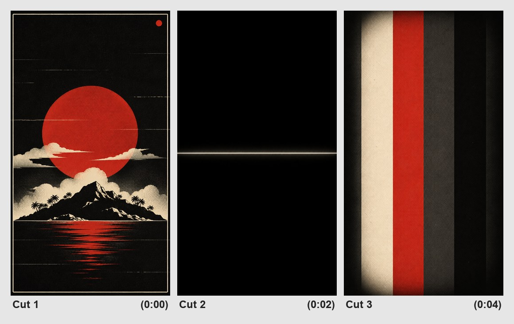

# V-07 엔딩 · 방송 중단 콘티

> 이슈 #51. 초안, 지영 승인 전. 세로 9:16, 7초, 컷 3개. 영상 안의 소리는 컷 프롬프트 안에 넣었다 (소리 프롬프트와 소리 표는 따로 없다). 규칙은 [RULES.md](../RULES.md)
> 쓰이는 곳: S-12 해설 카드 1 (엔딩). 범인이 이긴 판(동점 재투표나 무투표), 또는 추리가 시작된 뒤(r1 이후) 범인이 게임에서 나가 방송이 중단된 판에서 나온다 (D-025). 나간 경우의 안내 글 "범인 ○○이 자리를 떠나 방송이 중단됐어요"는 앱이 보여 준다. 변형 1개, 범인과 무관하다 (R-02). [V-06.md](V-06.md)와 짝이다: V-06은 램프가 켜지고 V-07은 신호가 끊긴다
> 주의: **지직거리는 잡음은 쓰지 않는다.** 작가 범인의 특징이 "무전기 지직거리는 소리"라서 닮은 소리가 범인 단서가 될 수 있다 (R-01). 신호 끊김은 부드러운 전기 웅웅임으로 만든다. 종원의 RV-02("삐—" 컬러바 톤)는 영상에 넣지 않는다 (R-13). 막대 화면이 켜지는 0:04에 RV-02가 나오도록 맞춘다 (VQ-17)

## 1. 공통 스타일
[V-01.md](V-01.md) 1번의 `{STYLE}`, `{AVOID}` 를 그대로 쓴다. 소리 금지는 이 영상용 `{NO-SOUND-S}` 를 쓴다.

**`{NO-SOUND-S}`** (V-01의 `{NO-SOUND}` 에 톤과 삐 소리를 더했다)
```
Audio avoid: voices, speech, lyrics, singing, melody, beep, test tone, sine tone, tone burst, jingle, notification or message tone, orchestral sting, radio static, crackle, walkie-talkie, any real broadcaster or app sound. Keep all sound quiet and in the background.
```

**소리 기본 톤:** 낮고 부드러운 전기 웅웅임이 떨리다가 낮아지며 사라지고, 마지막은 아주 작은 방 소리뿐이다. 음정이 있는 톤, 삐 소리, 지직거림은 없다. 글자는 영상에 넣지 않는다.

## 2. 컷 표
프롬프트 본문은 영어, 나머지는 한국어. 7초라서 세 컷을 한 번에 만든다 (시작 프레임 = 스토리보드 Cut 1, 참조 = Cut 2, 끝 프레임 = Cut 3). 컷마다 따로 만들 때는 표의 "영상 입력"을 쓴다.

| 컷 | 시각 (길이) | 장면 | 앱 자막 | 프롬프트 (영상 + 소리) |
| --- | --- | --- | --- | --- |
| C-01 | 0:00~0:02 (2초) | 방송 녹화 프레임. 얇은 아이보리 테두리, 어두운 바탕, 아래쪽에 붉은 해와 섬 실루엣. 화면이 가늘게 떨리고 가는 노이즈 줄이 지나가며, 모서리의 레드 REC 점이 두 번 깜빡이다 꺼진다. 글자 없음. 영상 입력: 시작 프레임 스토리보드 Cut 1 | 없음 | `{STYLE} Broadcast recording frame: a thin ivory rectangular frame near the edges on a near-black grainy field, a flat red sun above a dark island silhouette on still water at the bottom, a small vermilion record dot in the top-right corner. The picture starts to flicker and jitter with thin horizontal noise lines drifting across it, and the record dot blinks twice and goes out. No text. 2 seconds, 9:16. Audio: a soft steady low electrical hum fades in and wavers slightly, smooth and not crackling, nothing sharp. {AVOID} {NO-SOUND-S}` |
| C-02 | 0:02~0:04 (2초) | 화면 전체가 위아래에서 가운데로 줄어들어 밝은 가로 한 줄이 되었다가 작은 점으로 줄어 사라지고 완전한 암전이 된다. 글자 없음. 영상 입력: 참조 이미지 스토리보드 Cut 2 (가로 한 줄이 된 화면) | 없음 | `{STYLE} The whole picture shrinks vertically into a thin bright horizontal line across the middle of the frame, the line shrinks into a tiny dot, and the dot vanishes, leaving complete darkness. No text. 2 seconds, 9:16. Audio: the hum drops in pitch and fades out into near silence, smooth and not crackling. {AVOID} {NO-SOUND-S}` |
| C-03 | 0:04~0:07 (3초) | 완전한 어둠 속에서 팔레트 색(아이보리, 레드, 진한 회색, 검정) 세로 막대로 된 정지 화면이 켜진다. 막대는 가운데에 크게, 가장자리는 어둡게. 거의 움직이지 않고 필름 그레인만 약하게. 글자 없음. 이 막대가 켜지는 0:04에 종원의 RV-02가 나온다. 영상 입력: 끝 프레임 스토리보드 Cut 3 | 영상 아래에 앱이 보여 주는 글: "방송 중단" | `{STYLE} From complete darkness a still test-pattern style screen switches on: wide vertical bars in ivory, vermilion, charcoal gray and near-black fill the center of the frame, with the edges falling into dark. It holds almost perfectly still with only faint film grain. No text. 3 seconds, 9:16. Audio: only a very quiet low room tone, no tone, no beep. {AVOID} {NO-SOUND-S}` |

## 3. 스토리보드


칸 그림은 각 컷 프롬프트에서 소리와 길이를 뺀 프레임이다 (Cut 2는 가로 한 줄이 된 중간 모습, Cut 3은 끝 프레임으로 쓰는 막대 화면). 컷 번호와 시작 시각 글자는 모델이 그리지 않고 합칠 때 얹었다.

- 글 대체 문구: 화면이 떨리다 가로 한 줄로 줄어들며 꺼지고, 색 막대 화면만 남는다 (R-09). "방송 중단"은 앱이 따로 보여 준다
- 기록: [V-06.md](V-06.md) 3번과 같다 (같은 때 만든 6장 중 3장, 크레딧은 거기에 합쳐 적었다)
- 영상 생성 기록 (2026-11-26, 지영 요청): Higgsfield, Seedance 2.5 (`seedance_2_5`), 모드 `omni_reference`, 9:16, 480p(480×854), 24fps, 소리 생성 켬. 7초에 21 크레딧 (거래 내역 기준). 시드는 알려 주지 않았다. 프롬프트는 컷 표를 시간순으로 이은 합친 프롬프트이고, 입력은 시작 프레임 Cut 1, 참조 Cut 2, 끝 프레임 Cut 3다. 결과 [V-07_ending_v1.mp4](V-07_ending_v1.mp4) (7.04초, 0.75MB)는 검토용으로 이 폴더에 올렸다 (RULES §3 예외, VQ-3). 합친 프롬프트와 입력 이미지는 로컬 `_higgsfield-input/V-07/` 에만 있다
- 영상 확인: 컷 전환이 2.1초와 4.25초에 있다. 노이즈 줄이 지나가며 REC 점이 꺼지고, 화면이 가로 한 줄이 되었다가 암전이 되고, 4.25초에 막대 화면이 켜진다 (프레임 9개를 눈으로 봄). 막대가 켜지는 시각이 계획(0:04)보다 0.25초 늦어서 종원의 RV-02는 영상 기준 4.25초에 맞춘다 (VQ-17). 소리는 낮은 웅웅임(−33~−27dB)이 2.1초 컷 전환에서 한 번 튀고(−18dB), 3.1초(−24dB)와 4.2초(−29dB)에도 작게 튄 뒤 −44~−48dB의 아주 작은 방 소리가 이어진다 (완전한 무음은 아님). 가장 센 주파수가 43~120Hz의 낮은 웅웅임이라 삐 소리(높은 순음)는 없는 것으로 보이지만, 지직거림(R-01)은 측정으로 알 수 없고 소리를 귀로 확인하지 못했다
- 승인 때 볼 것: Cut 1에 야자나무와 구름이 있는데 시나리오에 없는 배경이다 (R-04). Cut 3 막대는 팔레트 색 4개이고 가운데가 살짝 왼쪽으로 치우쳤다. 실제 방송사 테스트 화면과 닮지 않게 했다 (R-06). 소리를 뺀 정지 프레임이라 지직거림 여부는 영상을 만들어 봐야 안다 (R-01)
