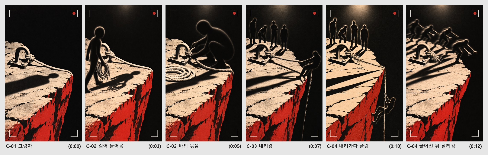

# V-09 과거 사고 재현 콘티

> 이슈 #71. 세로 9:16, 15초, 컷 4개. 스토리보드 지영 승인. 480p 검토 영상 있음. 규칙은 [RULES.md](../RULES.md)
> 쓰이는 곳: S-12 해설 카드 7 "과거 사고(3주 차)의 진실" (FR-070). 선택 영상(P6), 변형 1개. 과거 사고는 범인이 누구든 같은 고정 사실이라 범인과 무관하다 (R-02)
> 근거: PRD §28.4의 진실 (시나리오 JSON `pastTruth`): 절벽 로프 미션에서 서진의 안전 로프가 낡은 것으로 바꿔치기되어 추락, 크게 다침. 제작진이 시청률을 위해 덮음. 누가 바꿨는지는 시나리오에 없어서 보여 주지 않는다 (R-04, VQ-23)
> 그날 밤의 이야기: 촬영 준비를 끝낸 제작진이 모두 나간 빈 절벽에 누군가의 그림자가 드리워진다 → 그 형체가 걸어 들어와 낡은 로프로 바꾼다 → 시간이 흐른 뒤 출연진이 모여 촬영이 시작된다 → 서진이 매달린 차례에 로프가 끊어지고, 출연진이 절벽 끝으로 달려가며 화면이 검게 된다. 절벽을 향해 설치된 카메라 한 대의 원본으로 이 전체를 보여 준다. [V-03](V-03.md)(R3 원본)은 이 중 C-01과 C-03을 같이 쓰고, [V-02](V-02.md)(R2 편집본)는 C-03을 방송용으로 쓴다 (VQ-22, VQ-24)
> 화면: 모든 컷이 같은 카메라, 같은 시각(고정 고리, 로프, 가까운 절벽 끝)의 풀샷이다. 녹화 표시(아이보리 모서리, 레드 REC 점)가 있고 글자와 숫자는 없다 (R-06). 하늘의 해와 먼 섬은 없고, 조명 기구 없이 빛이 위에서 떨어진다
> 사람: 스태프, 로프를 바꾸는 형체, 출연진 모두 특징 없는 검은 그림자 형체로 그린다. 남자인지 여자인지, 체형, 얼굴, 옷, 볼캡, 걸음을 구별할 수 없다 (R-01, R-02). 로프에 매달린 형체는 절벽 아래로 사라지는 데까지만 보이고, 그 뒤와 부상, 피는 보여 주지 않는다 (R-10)
> 소리: 해설 카드를 넘기는 동안 종원의 RV-03(차분한 피아노 BGM)이 깔리므로 바탕은 멜로디 없이 밤바람과 먼 파도만 작게 낸다 (R-13). C-03 끝에 로프 섬유가 버티는 "빠드드득", C-04 끝에 화면이 검게 될 때 묵직하고 둔한 "쿵"을 짧게 넣고 RV-03보다 튀지 않게 맞춘다. 비명과 음성은 없다 (R-10)

## 1. 공통 스타일
[V-01.md](V-01.md) 1번의 `{STYLE}`, `{AVOID}` 를 쓰고, 색은 `{COLOR-N}` 을 더한다 (V-02, V-03도 같다). 녹화 표시는 모델이 그리지 않고 편집으로 얹는다 (모델이 위치를 틀리게 그린다). Higgsfield 프롬프트는 필터에 걸릴 만한 말을 사물의 움직임으로 돌려 쓴다 (끊어짐은 "섬유가 한 가닥씩 풀린다", 쿵은 "멀리 아래에서 묵직하고 둔한 소리").

**`{COLOR-N}`** (그날 밤 세 영상의 색)
```
Colors: warm cream ivory rock top surface, flat vermilion red #BF3026 cliff side face with halftone texture and dark cracks, near-black background and shadows, warm sepia tone overall.
```

**`{NO-SOUND-P}`** (C-01, C-02. V-01의 `{NO-SOUND}` 에 비명, 충돌음, 피아노를 더했다. 피아노는 종원의 RV-03 몫이다)
```
Audio avoid: voices, speech, scream, shouting, crying, breathing, lyrics, singing, melody, piano, music, jingle, notification or message tone, orchestral sting, impact, thud, crash, heartbeat, radio static, crackle, walkie-talkie, beep, any real broadcaster or app sound. Keep all sound quiet and in the background.
```

**`{NO-SOUND-P2}`** (C-03, C-04. 빠드드득과 쿵 때문에 충돌음 세 단어를 뺐다)
```
Audio avoid: voices, speech, scream, shouting, crying, breathing, lyrics, singing, melody, piano, music, jingle, notification or message tone, orchestral sting, heartbeat, radio static, crackle, walkie-talkie, beep, any real broadcaster or app sound. Keep the rest of the sound quiet and in the background.
```

## 2. 컷 표
C-01에서 C-02는 끊기지 않고 이어지고, C-02에서 C-03으로 시간이 흐르는 곳은 화면이 잠깐 검게 끊겼다 이어진다 (시각 숫자는 시나리오에 없어 넣지 않는다, R-04).

| 컷 | 시각 (길이) | 장면 | 앱 자막 | 프롬프트 (영상 + 소리) |
| --- | --- | --- | --- | --- |
| C-01 | 0:00~0:03 (3초) | 밤, 제작진이 모두 떠난 빈 절벽 위. U자 고정 고리에 새 아이보리 로프가 묶여 가까운 절벽 끝으로 이어진다. 화면 밖에 선 누군가의 그림자(머리, 목, 어깨가 보이는 사람 그림자, 특징 없음)가 왼쪽에서 바위 위로 길게 드리워지며 로프 쪽으로 다가온다 | 없음 (카드 7의 해설 글은 앱이 따로 보여 준다) | `{STYLE} {COLOR-N} Raw footage from one fixed camera on a night cliff top. A U-shaped metal anchor bolt on the cracked rock top with a fresh ivory twisted rope tied to it, running to the nearby cliff edge. The cliff top is empty. The long, soft, featureless cast shadow of one person who is still out of frame, with a clear rounded head, neck and shoulders, slides in from the left across the rock toward the rope. Hard white light from above, no lamp, no sky, no sun, no island. No text. 3 seconds, 9:16. Audio: a cold night wind and distant waves far below, slow footsteps on rock coming closer, no melody. {AVOID} {NO-SOUND-P}` |
| C-02 | 0:03~0:07 (4초) | C-01에서 끊기지 않고 이어진다. 그림자의 주인인 검은 그림자 형체가 낡은 회색 로프 한 묶음을 들고 왼쪽에서 걸어 들어와 고리 앞에 웅크린다 → 새 로프를 풀어 옆에 감아 두고 낡은 로프로 바꿔 묶는다 → 다시 걸어 나간다. 남녀, 체형을 구별할 수 없는 매끈한 형체다 | 없음 | `{STYLE} {COLOR-N} Continuing without a cut, same camera angle. The owner of the shadow, a featureless solid black person-shaped figure with soft blurred edges and a smooth rounded body, no face and no details, walks in from the left carrying a coil of old frayed gray rope, crouches at the anchor, unties the fresh ivory rope, sets it aside coiled on the rock and ties the old frayed gray rope with worn fibers in its place, then walks away out of frame. No text. 4 seconds, 9:16. Audio: footsteps on rock, wind and a faint rustle of rope, no melody. {AVOID} {NO-SOUND-P}` |
| C-03 | 0:07~0:10 (3초) | 화면이 잠깐 검게 끊겼다 이어진다 (시간이 흐름). 출연진(검은 그림자 형체)이 고리 뒤에 모여 서서 지켜보며 제자리에서 조금씩 움직인다 (천천히 박수를 치거나, 허리에 손을 올리거나, 팔짱을 끼거나, 몸무게를 옮기는 정도. 달려가지는 않는다). 로프는 이미 고리에서 절벽 아래로 풀려 늘어져 있다. 서진(검은 그림자 형체) 한 명이 절벽 끝에서 로프를 잡고 뒤로 기대어 절벽 아래로 천천히 내려간다. 로프에는 이 한 명만 있다. 끝 무렵 로프가 팽팽하게 늘어지며 해진 섬유가 버티는 "빠드드득" 소리가 난다 | 없음 | `{STYLE} {COLOR-N} The picture blinks and comes back, same camera angle. Four featureless black shadow figures stand together behind the anchor, watching and moving a little in place: one claps slowly, one puts its hands on its hips, one crosses its arms, one shifts its weight. They stay in place and do not run. The frayed rope already runs from the anchor knot over the cliff edge and hangs down the cliff face. One featureless black shadow figure at the edge holds the rope, leans back and climbs down below the edge hand over hand, slowly lowering down the cliff face. Only this one figure is on the rope; no other figure appears on the rope or below the edge. Near the end the rope stretches tight and its worn fibers strain. No text. 3 seconds, 9:16. Audio: wind and waves; at the end a tense creaking and popping strain of rope fibers stretching tight. {AVOID} {NO-SOUND-P2}` |
| C-04 | 0:10~0:15 (5초) | C-03과 같은 화각. 서진이 절벽 아래로 내려가는 중에 로프가 처음엔 살짝 늘어지며 해진 섬유가 버틴다 → 한 번 더 훅 풀리며 고리 옆이 가늘어진다 → 섬유가 한 가닥씩 풀리며 끊어지고, 고리에는 짧은 로프 끝만 남은 채 로프와 내려가던 형체가 순식간에 절벽 아래로 사라진다 → 그 뒤에야 나머지 출연진(검은 그림자 형체)이 로프가 넘어간 절벽 끝으로 달려가고, 그대로 화면이 검게 페이드 아웃된다. 검게 될 때 묵직하고 둔한 "쿵" | 없음 | `{STYLE} {COLOR-N} Same wide camera angle as shot 3, no zoom. While the figure is partway down the cliff face, the frayed rope stretches tight and sags slightly while the worn fibers next to the anchor knot creak; then with a sudden jolt it unravels further and grows thin; then the last fibers come apart, leaving only a short frayed end on the anchor, and in a split second the rope and the figure on it whip down out of view below the edge. Only after that, the other featureless black shadow figures rush toward the edge where the rope went over, and the picture fades to black. No text. 5 seconds, 9:16. Audio: creaking strain of rope fibers, a sudden jolt and a dry tearing of fibers, a fast rush of air, hurried footsteps on rock; as the picture fades to black, one deep, muffled, heavy low sound from far below, then near silence. {AVOID} {NO-SOUND-P2}` |

## 3. 스토리보드


칸은 C-01, C-02(걸어 들어옴), C-02(바꿔 묶음), C-03(내려감), C-04(내려가다 풀림), C-04(끊어진 뒤 달려감) 여섯 개다. 녹화 표시와 컷 번호, 시작 시각 글자는 합칠 때 얹었다.

- 그림: Higgsfield, GPT Image 2.6 (`gpt_image_2_6`), 화질 medium, 1k, 9:16, 칸마다 1 크레딧. C-02(바꿔 묶음)와 C-03은 C-01 그림을, C-02(걸어 들어옴)는 C-02 그림과 C-01 그림자를, C-04 두 칸은 C-03 그림을 참조로 넣어 같은 화각, 같은 고리와 로프, 같은 색(`{COLOR-N}`)으로 맞췄다. 시드는 도구가 알려 주지 않는다
- 영상: Higgsfield, Seedance 2.5 (`seedance_2_5`), 모드 `omni_reference`, 9:16, 480p(480×854), 24fps, 소리 생성 켬. 두 번 만들어 이었다. ① C-01~C-02: 15초, 45 크레딧, 시작 프레임 C-01, 참조 C-02(걸어 들어옴), C-02(바꿔 묶음), C-03, C-04 그림 (로컬 `_higgsfield-input/V-09/night15/prompt.txt`). 이 중 깜빡임까지(0~7.42초)만 쓴다. ② C-03~C-04: 8초, 24 크레딧, 시작 프레임 C-03, 참조 C-04(끊어진 뒤 달려감) 그림. C-04(내려가다 풀림) 그림은 절벽 모양과 밝기가 C-03과 달라 참조로 넣으면 영상의 절벽이 그쪽으로 바뀌므로 넣지 않는다 (로컬 `_higgsfield-input/V-09/night15/prompt_c03c04.txt`). 녹화 표시는 그리지 않게 했다
- 편집: ①의 0~7.42초(7.00~7.42초 검은 깜빡임 포함)에 ②의 0~7.58초를 이어 15.0초로 맞췄다. 녹화 표시를 가운데(480 기준 여백 좌우 27px, 위아래 29px)에 얹었고, 깜빡임 동안은 표시도 꺼진다. ②는 끝에서 바로 검게 바뀌어서 13.71초부터 페이드 아웃으로 바꿨고, 14.21초부터 끝까지 완전한 검정이다 (표시도 없다). 소리는 깜빡임 때 나는 낮은 울림(7.0초)을 14dB 낮추고, 14.4초부터 끝의 울림을 줄이고, 최대치를 제한했다 (최대 −4.1dBFS). 결과 [V-09_cliff_v1.mp4](V-09_cliff_v1.mp4) (15.0초, 1.47MB, RULES §3 검토용 예외). 원본과 입력 그림은 로컬 `_higgsfield-input/V-09/night15/`
- 영상 확인 (0.5초 간격 프레임, 이은 곳과 끊어지는 곳은 12~24fps 프레임): 0.5초부터 사람 그림자가 왼쪽에서 들어오고, 2.3초에 형체가 로프 묶음을 들고 들어와 4.0~6.0초 고리 앞에 웅크려 바꿔 묶고, 6.5초에 걸어 나간다. 7.00~7.42초 깜빡임 뒤에는 로프가 이미 절벽 아래로 늘어져 있고, 출연진 넷은 고리 뒤 제자리에서 천천히 박수를 치거나 허리에 손을 올리거나 팔짱을 끼는 정도로 조금씩 움직이고, 한 명이 절벽 끝에서 로프를 잡고 뒤로 기대어 8.4초쯤 절벽 아래로 내려간다. 로프에는 이 한 명만 있다. 내려가는 동안 고리 옆 섬유가 풀려 보이다가 12.4초쯤 로프가 끊어져 고리에 짧은 끝만 남고, 로프와 내려가던 형체가 순식간에 절벽 아래로 사라진다. 그 뒤 12.9초부터 출연진이 절벽 끝으로 달려가고 그대로 어두워진다. 절벽 모양, 빨간 옆면, 색은 깜빡임 뒤부터 끝까지 그대로이고, 바위가 조금 밝아지는 것은 내려가는 사람의 그림자가 절벽 아래로 사라지기 때문이다. 화면 모서리에 모델이 그린 표시는 없다. 소리(측정만): 바탕 −40dB 안팎, 11.9~12.2초 높은 소리(빠드드득 후보), 12.4초 끊어지는 소리(−20dB), 14.2초 검게 될 때 낮은 소리(−24dB, 쿵 후보)
- 글 대체 문구: 절벽을 찍던 카메라 앞에 누군가의 그림자가 드리워지고 그 형체가 걸어 들어와 로프를 낡은 것으로 바꾸고, 시간이 흐른 뒤 출연진 한 명이 그 로프를 잡고 절벽 아래로 내려가다 로프가 고리 옆에서 끊어져 함께 사라지고, 나머지가 절벽 끝으로 달려가며 화면이 검게 된다 (R-09)
- 남은 확인: C-04의 "살짝 늘어짐 → 훅 풀려 가늘어짐" 단계는 뚜렷하지 않다 (팽팽한 채 고리 옆 섬유가 풀려 보이다가 한 번에 끊어진다). 깜빡임 뒤 0.5초쯤 바위 위의 긴 그림자가 옅어진다. 14.21초부터 끝(15.0초)까지는 검은 화면에 쿵과 낮은 울림만 있다. 빠드드득과 쿵이 의도대로 들리는지는 사람이 들어 봐야 한다. 형체들에 누구인지 알 수 있는 특징이 없는지 (R-01, R-02). 로프를 바꾼 사람은 정연이 정한다 (VQ-23). 길이 15초는 제안이고, 엔딩과 같은 10초 이내 기준보다 길다 (VQ-20)
